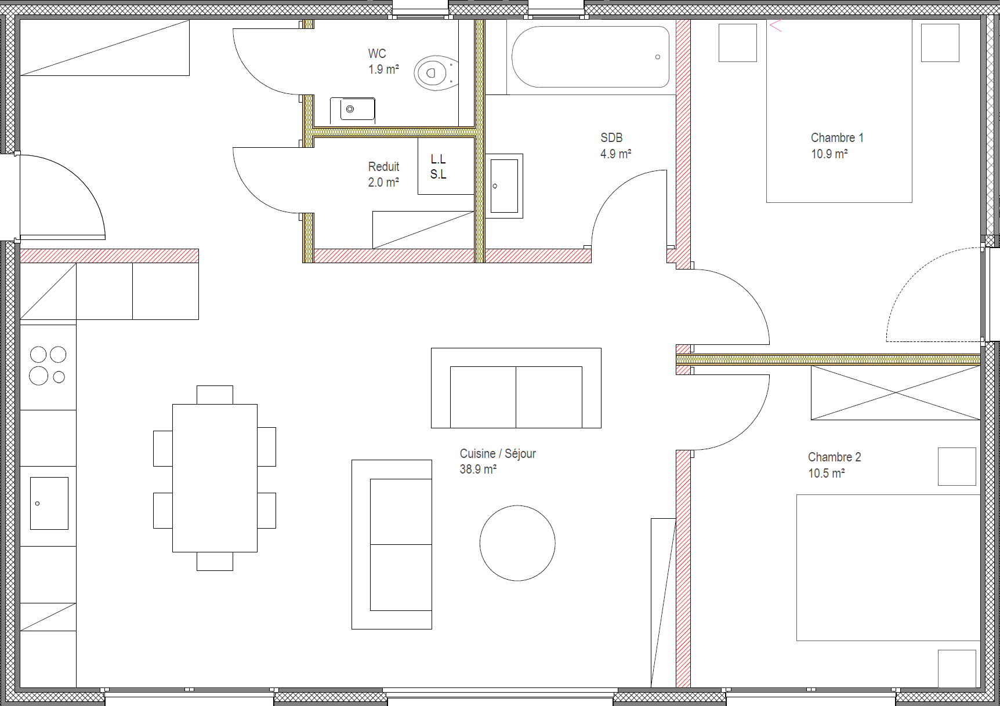

---
# Welcome book (livret d'accueil)
#
# Unlisted page: it is not in the navbar of _quarto-en.yml / _quarto-fr.yml and
# should stay out of it. Addresses:
#   English  https://www.monts-chalet.ch/welcomebook.html
#   French   https://www.monts-chalet.ch/fr/welcomebook.html
#
# As on the other pages of the site, each text exists twice: once marked
# when-profile="fr" and once marked when-profile="en".
# Styles: welcomebook.css    Images: images/welcomebook/
# PDF button: it links to the PDF that is already in the repository, in documents/.
# To remove the button, delete the two lines containing "PDF" just below this header.
pagetitle: "Livret d’accueil | Welcome book"
body-classes: wb-page
page-layout: article
toc: true
toc-depth: 3
# In-page links glide to their target and land just below the navbar
smooth-scroll: true
css: welcomebook.css
# Asks search engines not to list the page
include-in-header:
  - text: |
      <meta name="robots" content="noindex, nofollow">
---

# [Livret d’accueil]{.content-visible when-profile="fr"}[Welcome book]{.content-visible when-profile="en"} {#wb-top}

:::: {.content-visible when-profile="fr"}
::: {.wb-lead}
L’appartement by Monts-Chalet
:::

::: {.wb-actions}
[ Télécharger le PDF](<documents/Livret d'accueil L'appartement by Monts-Chalet.pdf>){.btn .btn-outline-dark rel="nofollow"}
[ English version](../welcomebook.html){.btn .btn-outline-dark}
:::
::::

:::: {.content-visible when-profile="en"}
::: {.wb-lead}
The Apartment by Monts-Chalet
:::

::: {.wb-actions}
[ Download the PDF](<documents/Livret d'accueil L'appartement by Monts-Chalet.pdf>){.btn .btn-outline-dark rel="nofollow"}
[ Version française](fr/welcomebook.html){.btn .btn-outline-dark}
:::
::::

<!-- ===================== L'essentiel / The essentials ===================== -->

## []{.wb-ico} [L’essentiel]{.content-visible when-profile="fr"}[The essentials]{.content-visible when-profile="en"} {#essentials}

:::::: {.content-visible when-profile="fr"}
:::: {.wb-tiles}
::: {.wb-tile}
[]{.wb-tile-ico}
[Wi-Fi]{.wb-tile-label}
[MontsChaletApt]{.wb-tile-value}
[sans mot de passe]{.wb-tile-note}
:::

::: {.wb-tile}
[]{.wb-tile-ico}
[Arrivée]{.wb-tile-label}
[16:00]{.wb-tile-value}
[au plus tôt]{.wb-tile-note}
:::

::: {.wb-tile}
[]{.wb-tile-ico}
[Départ]{.wb-tile-label}
[11:00]{.wb-tile-value}
[au plus tard]{.wb-tile-note}
:::
::::

:::: {.wb-emergency}
[ Numéros d’urgence]{.wb-emergency-title}

::: {.wb-numbers}
[[117]{.wb-num} Police](tel:117)
[[118]{.wb-num} Feu](tel:118)
[[144]{.wb-num} Ambulance](tel:144)
[[145]{.wb-num} Intoxication](tel:145)
[[1414]{.wb-num} Rega, sauvetage aérien](tel:1414)
[[0848 133 133]{.wb-num} Médecins de garde](tel:0848133133)
:::

[ Adresse à indiquer aux secours]{.wb-emergency-label}
[Chemin de la Vuargnaz 5, 1865 Les Diablerets]{.wb-emergency-address}
::::

:::: {.wb-reminders}
::: {.wb-reminder}
[]{.wb-ico}
[Aérez les pièces d’eau](#airing)
Pas de ventilation&nbsp;: ouvrez les fenêtres de la salle de bain et des toilettes.
:::

::: {.wb-reminder}
[]{.wb-ico}
[Chauffage au sol](#heating)
Réglage par thermostats, l’effet se fait sentir après quelques heures.
:::

::: {.wb-reminder}
[]{.wb-ico}
[Vos clés au départ](#keys)
Clé avec télécommande&nbsp;: à laisser dans le logement. Autre clé&nbsp;: dans la boîte à clés.
:::

::: {.wb-reminder}
[]{.wb-ico}
[Avant de partir](#cleaning)
Ordures aux moloks, cuisine et vaisselle rangées, linge dans la buanderie.
:::

::: {.wb-reminder}
[]{.wb-ico}
[Incendie et premiers secours](#fire-first-aid)
Extincteur dans la buanderie. Couverture anti-feu et kit premiers secours sous le lavabo de la cuisine.
:::

::: {.wb-reminder}
[]{.wb-ico}
[Stations de recharge](#ev-charging)
Des stations de recharges sont disponibles au village et au col du Pillon.
:::
::::

::: {.wb-rules}
[[]{.wb-no} Merci de vous déchausser]{.wb-rule}
[ Strictement non-fumeur]{.wb-rule}
[[]{.wb-no} Animaux non admis]{.wb-rule}
:::

::: {.wb-question}
Une question&nbsp;? [info@monts-chalet.ch](mailto:info@monts-chalet.ch)
:::

::: {.wb-contents}
[[]{.wb-ico} Se rendre à Monts-Chalet](#getting-there)
[[]{.wb-ico} Arrivée et départ](#arrival-departure)
[[]{.wb-ico} La vie à Monts-Chalet](#life)
[[]{.wb-ico} Informations pratiques](#useful-info)
[[]{.wb-ico} Visiter la région](#area)
[[]{.wb-ico} Activités d’hiver](#winter)
:::
::::::

:::::: {.content-visible when-profile="en"}
:::: {.wb-tiles}
::: {.wb-tile}
[]{.wb-tile-ico}
[Wi-Fi]{.wb-tile-label}
[MontsChaletApt]{.wb-tile-value}
[no password]{.wb-tile-note}
:::

::: {.wb-tile}
[]{.wb-tile-ico}
[Check-in]{.wb-tile-label}
[16:00]{.wb-tile-value}
[at the earliest]{.wb-tile-note}
:::

::: {.wb-tile}
[]{.wb-tile-ico}
[Check-out]{.wb-tile-label}
[11:00]{.wb-tile-value}
[at the latest]{.wb-tile-note}
:::
::::

:::: {.wb-emergency}
[ Emergency numbers]{.wb-emergency-title}

::: {.wb-numbers}
[[117]{.wb-num} Police](tel:117)
[[118]{.wb-num} Fire](tel:118)
[[144]{.wb-num} Ambulance](tel:144)
[[145]{.wb-num} Poisoning](tel:145)
[[1414]{.wb-num} Rega, air rescue](tel:1414)
[[0848 133 133]{.wb-num} Doctors on call](tel:0848133133)
:::

[ Address to give to the emergency services]{.wb-emergency-label}
[Chemin de la Vuargnaz 5, 1865 Les Diablerets]{.wb-emergency-address}
::::

:::: {.wb-reminders}
::: {.wb-reminder}
[]{.wb-ico}
[Air the bathroom and toilet](#airing)
No ventilation: please open their windows.
:::

::: {.wb-reminder}
[]{.wb-ico}
[Underfloor heating](#heating)
Set with the thermostats, changes take a few hours.
:::

::: {.wb-reminder}
[]{.wb-ico}
[Keys at check-out](#keys)
Key with remote: leave it inside. Other key: back in the key box.
:::

::: {.wb-reminder}
[]{.wb-ico}
[Before you leave](#cleaning)
Rubbish to the moloks, kitchen and dishes clean, linen in the utility room.
:::

::: {.wb-reminder}
[]{.wb-ico}
[Fire and first aid](#fire-first-aid)
Extinguisher in the utility room. Fire blanket and first aid kit under the kitchen sink.
:::

::: {.wb-reminder}
[]{.wb-ico}
[Charging stations](#ev-charging)
Charging stations are located in the village and at the col du Pillon.
:::
::::

::: {.wb-rules}
[[]{.wb-no} Please take off your shoes]{.wb-rule}
[ Strictly non-smoking]{.wb-rule}
[[]{.wb-no} Pets are not allowed]{.wb-rule}
:::

::: {.wb-question}
Any questions? [info@monts-chalet.ch](mailto:info@monts-chalet.ch)
:::

::: {.wb-contents}
[[]{.wb-ico} Arriving at Monts-Chalet](#getting-there)
[[]{.wb-ico} Arrival and departure](#arrival-departure)
[[]{.wb-ico} Life at Monts-Chalet](#life)
[[]{.wb-ico} Useful information](#useful-info)
[[]{.wb-ico} Visiting the area](#area)
[[]{.wb-ico} Winter activities](#winter)
:::
::::::

<!-- ============ 1. Se rendre à Monts-Chalet / Arriving at Monts-Chalet ============ -->

## []{.wb-ico} [Se rendre à Monts-Chalet]{.content-visible when-profile="fr"}[Arriving at Monts-Chalet]{.content-visible when-profile="en"} {#getting-there}

### []{.wb-ico} [Adresse]{.content-visible when-profile="fr"}[Address]{.content-visible when-profile="en"} {#address}

::: {.content-visible when-profile="fr"}
Chemin de la Vuargnaz 5, 1865 Les Diablerets, Suisse.
:::

::: {.content-visible when-profile="en"}
Chemin de la Vuargnaz 5, 1865 Les Diablerets, Switzerland.
:::

### []{.wb-ico} [Plan d’accès]{.content-visible when-profile="fr"}[Access map]{.content-visible when-profile="en"} {#access-map}

:::: {.content-visible when-profile="fr"}
::: {.wb-map}
[ Ouvrir dans Google Maps](https://www.google.com/maps/search/?api=1&query=46.355306%2C7.157194){.btn .btn-outline-dark}
:::
::::

:::: {.content-visible when-profile="en"}
::: {.wb-map}
[ Open in Google Maps](https://www.google.com/maps/search/?api=1&query=46.355306%2C7.157194){.btn .btn-outline-dark}
:::
::::

### []{.wb-ico} [Coordonnées GPS]{.content-visible when-profile="fr"}[GPS coordinates]{.content-visible when-profile="en"} {#gps}

[46°21\'19.1\"N 7°09\'25.9\"E](https://www.google.com/maps/search/?api=1&query=46.355306%2C7.157194)

### []{.wb-ico} [Transports]{.content-visible when-profile="fr"}[Transport]{.content-visible when-profile="en"} {#transport}

####  [En voiture]{.content-visible when-profile="fr"}[By car]{.content-visible when-profile="en"} {#by-car}

::: {.content-visible when-profile="fr"}
Autoroute A9-E27 sortie 17 (Aigle - Ollon - Les Mosses - Vionnaz). Suivre ensuite la direction Les Diablerets.
:::

::: {.content-visible when-profile="en"}
Motorway A9-E27, exit 17 (Aigle - Ollon - Les Mosses - Vionnaz). Then follow the direction of Les Diablerets.
:::

####  [En train]{.content-visible when-profile="fr"}[By train]{.content-visible when-profile="en"} {#by-train}

::: {.content-visible when-profile="fr"}
Depuis la gare d’Aigle, prendre la ligne Aigle - Le Sépey - Les Diablerets. Horaires disponibles sur le site des transports publics du Chablais sur [www.tpc.ch](https://www.tpc.ch). Afin de se rendre à Aigle, prendre un train CFF. Horaires et vente sur [www.cff.ch](https://www.cff.ch).
:::

::: {.content-visible when-profile="en"}
From Aigle train station, take the line Aigle - Le Sépey - Les Diablerets. Timetable available on the site of Transports Publics du Chablais on [www.tpc.ch](https://www.tpc.ch). To reach Aigle, take a CFF train. Timetable and ticketing on [www.cff.ch](https://www.cff.ch).
:::

####  [En avion]{.content-visible when-profile="fr"}[By plane]{.content-visible when-profile="en"} {#by-plane}

::: {.content-visible when-profile="fr"}
Aéroport de Genève à 130 km, aéroport de Sion à 75 km et aéroport de Zurich à 250 km.
:::

::: {.content-visible when-profile="en"}
Geneva airport at 130 km, Sion airport at 75 km and Zurich airport at 250 km.
:::

### []{.wb-ico} Parking {#parking}

::: {.content-visible when-profile="fr"}
Un garage et des places de parc sont disponibles.
:::

::: {.content-visible when-profile="en"}
One garage and outside parking spaces are available.
:::

<!-- ================ 2. Arrivée et départ / Arrival and departure ================ -->

## []{.wb-ico} [Arrivée et départ]{.content-visible when-profile="fr"}[Arrival and departure]{.content-visible when-profile="en"} {#arrival-departure}

### []{.wb-ico} [Clés]{.content-visible when-profile="fr"}[Keys]{.content-visible when-profile="en"} {#keys}

::: {.content-visible when-profile="fr"}
Deux clés du logement, dont une avec la télécommande d’accès au garage, sont fournies lors de votre arrivée. Lors de votre départ, merci de laisser la clé avec télécommande à l’intérieur du logement et de remettre l’autre clé dans la boîte à clés.
:::

::: {.content-visible when-profile="en"}
Two keys are provided at check-in, one of them with the garage access remote. At check-out, please leave the key with the remote inside the apartment and put the other key back in the key box.
:::

### []{.wb-ico} [Heure d’arrivée et de départ]{.content-visible when-profile="fr"}[Check-in and check-out time]{.content-visible when-profile="en"} {#check-times}

::: {.content-visible when-profile="fr"}
L’entrée dans les lieux se fait à partir de 16:00. Le départ doit se faire au plus tard à 11:00.
:::

::: {.content-visible when-profile="en"}
Check-in time is from 16:00 and departure should be done by 11:00 on the check-out day.
:::

### []{.wb-ico} [État des lieux]{.content-visible when-profile="fr"}[Inventory]{.content-visible when-profile="en"} {#inventory}

::: {.content-visible when-profile="fr"}
Un état des lieux d’entrée est organisé à votre arrivée. Votre caution vous sera restituée (en espèces ou par virement) si aucun défaut n’est observé lors de votre départ.
:::

::: {.content-visible when-profile="en"}
An inventory will be organised during the check-in process. Your security deposit will be returned if no defect is observed at check-out (by cash or bank transfer).
:::

### []{.wb-ico} [Ménage]{.content-visible when-profile="fr"}[Cleaning]{.content-visible when-profile="en"} {#cleaning}

::: {.content-visible when-profile="fr"}
Le ménage à la fin du séjour, le prêt du linge de maison, de lit et de bain sont inclus dans le prix.

Cependant, avant de quitter le logement nous vous demandons de&nbsp;:

- Sortir vos ordures et les déposer dans les moloks prévus à cet effet (situés au village et en face de la Coop). Merci d’utiliser uniquement les sacs officiels de la commune des Diablerets mis à votre disposition et de faire le tri du verre, papier et PET
- Ranger la cuisine et la vaisselle
- Rassembler le linge de maison, de lit et de bain et les laisser dans la buanderie. Les alèses restent sur les lits et les couettes doivent être pliées
- Passer un coup de balai, d’aspirateur ou de panosse/serpillière (uniquement si nécessaire)
:::

::: {.content-visible when-profile="en"}
Cleaning at the end of the stay, loan of linen, bed linen and towels are included in the rent.

Before checking out, we ask you to:

- Take your rubbish out to the moloks (available at different places in the village and in front of the Coop supermarket). Please only use the official rubbish bags of the village put at your disposal and sort glass, paper and PET plastic
- Clean the kitchen and dishes
- Gather linen, bed linen, and towels in the utility room. Mattress pads remain on the beds and duvets must be folded
- Sweep, vacuum or mop (only if needed)
:::

<!-- ================ 3. La vie à Monts-Chalet / Life at Monts-Chalet ================ -->

## []{.wb-ico} [La vie à Monts-Chalet]{.content-visible when-profile="fr"}[Life at Monts-Chalet]{.content-visible when-profile="en"} {#life}

### []{.wb-ico} [Plans du logement]{.content-visible when-profile="fr"}[Floor plans]{.content-visible when-profile="en"} {#floor-plan}

:::: {.content-visible when-profile="fr"}
Le logement est composé d’une chambre double, une chambre avec trois lits superposés, une salle de bain, une toilette séparée et une buanderie. La pièce à vivre et les chambres à coucher donnent accès à une terrasse orientée plein sud.

{.wb-plan .lightbox fig-alt="Plan de l’appartement"}

::: {.wb-legend}
Légende&nbsp;: SDB = salle de bain · Réduit = buanderie · L.L / S.L = lave-linge / sèche-linge
:::
::::

:::: {.content-visible when-profile="en"}
The accommodation is composed of one double bedroom, one bedroom with three bunk beds, one bathroom, one separate toilet and one utility room. The living room and the bedrooms have access to the south-facing terrace.

{.wb-plan .lightbox fig-alt="Floor plan of the apartment"}

::: {.wb-legend}
Key: Chambre = bedroom · SDB = bathroom · WC = toilet · Réduit = utility room · Cuisine / Séjour = kitchen / living room · L.L / S.L = washing machine / tumble dryer
:::
::::

### []{.wb-ico} [Incendies et premiers secours]{.content-visible when-profile="fr"}[Fire and first aid]{.content-visible when-profile="en"} {#fire-first-aid}

::: {.content-visible when-profile="fr"}
Un extincteur est disponible dans la buanderie ainsi qu’une couverture anti-feu et un kit premiers secours sous le lavabo de la cuisine.
:::

::: {.content-visible when-profile="en"}
A fire extinguisher is available in the utility room as well as a fire blanket and a first aid kit under the sink of the kitchen.
:::

### []{.wb-ico} [Divertissements]{.content-visible when-profile="fr"}[Entertainment]{.content-visible when-profile="en"} {#entertainment}

####  [Livres et jeux de société]{.content-visible when-profile="fr"}[Books and board games]{.content-visible when-profile="en"} {#books-and-board-games}

::: {.content-visible when-profile="fr"}
Divers livres et documents sur l’histoire de la Suisse, les activités et la gastronomie locale ainsi que des jeux de société pour tous les âges sont disponibles en français et en anglais.
:::

::: {.content-visible when-profile="en"}
Various books and documents about the history of Switzerland, local activities and gastronomy, as well as board games for all ages are available in French and English.
:::

####  Wi-Fi {#wi-fi}

::: {.content-visible when-profile="fr"}
Le réseau wifi MontsChaletApt couvre la totalité du logement et est accessible sans mot de passe.
:::

::: {.content-visible when-profile="en"}
The Wi-Fi network MontsChaletApt covers the entire accommodation and no password is required.
:::

####  [Multimédia]{.content-visible when-profile="fr"}[Multimedia]{.content-visible when-profile="en"} {#multimedia}

::: {.content-visible when-profile="fr"}
Une télévision avec des chaînes internationales en différentes langues est à votre disposition. La télévision inclut également une interface permettant d’accéder aux contenus en ligne (YouTube et Google Music notamment).

Le système son du salon permet également de diffuser de la musique via les contenus en ligne de la télévision ou d’y connecter vos appareils personnels en Bluetooth.
:::

::: {.content-visible when-profile="en"}
A television with international channels in different languages is available. The television also includes an interface to access online content (including YouTube and Google Music).

The sound system also allows you to stream music via TV online content or connect your personal devices via Bluetooth.
:::

####  [Local à skis]{.content-visible when-profile="fr"}[Ski storage room]{.content-visible when-profile="en"} {#ski-storage-room}

::: {.content-visible when-profile="fr"}
Un local à skis est à votre disposition dans le garage. Vous pourrez y faire sécher vos paires de chaussures de ski et y entreposer vos skis et bâtons.

Des paires de raquettes à neige adultes ainsi que leurs bâtons et des paires de raquettes enfants vous attendent dans ce local. Vous pourrez également librement profiter de luges en bois et de luges en plastique pour les enfants.

Merci de noter que l’utilisation des luges mises à disposition est interdite sur la piste de luge de 7 km des Diablerets. Des loueurs accrédités sont disponibles au départ de la télécabine Meillerets Express.
:::

::: {.content-visible when-profile="en"}
A ski storage room is available in the garage. You can dry your pairs of ski boots and store your skis and poles.

Pairs of adult snowshoes and their poles and pairs of children’s snowshoes are at your disposal in this room. You can also freely enjoy some wooden sledges and children’s plastic sledges.

Please note that the use of the provided sledges is prohibited on the 7 km sledge run of Les Diablerets. Approved rental companies are available at the departure of Meillerets Express gondola.
:::

### []{.wb-ico} [Équipements]{.content-visible when-profile="fr"}[Equipment]{.content-visible when-profile="en"} {#equipment}

####  [Linge de maison]{.content-visible when-profile="fr"}[Linen]{.content-visible when-profile="en"} {#linen}

::: {.content-visible when-profile="fr"}

Un ensemble de linge de maison est disponible

- **2** linges de cuisine (torchons)
- **1** set de table par personne
- **1** serviette de table par personne
- **4** sets de table pour enfants
- **1** manique
- **1** porte plats à four
- **1** tablier de cuisine

:::

::: {.content-visible when-profile="en"}

A set of linen is available

- **2** kitchen towels (tea towels)
- **1** table mat per person
- **1** napkin per person
- **4** children’s table mats
- **1** oven glove
- **1** oven potholder
- **1** cooking apron

:::

####  [Linge de lit]{.content-visible when-profile="fr"}[Bed linen]{.content-visible when-profile="en"} {#bed-linen}

::: {.content-visible when-profile="fr"}
Un ensemble de linge de lit est disponible par chambre.
:::

::: {.content-visible when-profile="en"}
A set of bed linen is available in each room.
:::

####  [Linge de bain]{.content-visible when-profile="fr"}[Bath linen]{.content-visible when-profile="en"} {#bath-linen}

::: {.content-visible when-profile="fr"}
Chaque hôte a à sa disposition&nbsp;:

- 1 grande serviette de toilette
- 1 gant de toilette.

Un tapis de bain est disposé dans la salle de bain. Une serviette à mains est disponible dans les toilettes et dans la salle de bain.

Un sèche-cheveux et une raclette à douche sont disposés dans la salle de bain.
:::

::: {.content-visible when-profile="en"}
A set of bath linen is available for each guest:

- 1 large bath towel
- 1 face cloth.

A bath mat is available in the bathroom. A hand towel is available in the toilet and in the bathroom.

You will find a hair dryer and a shower squeegee in the bathroom.
:::

####  [Buanderie]{.content-visible when-profile="fr"}[Utility room]{.content-visible when-profile="en"} {#utility-room}

::: {.content-visible when-profile="fr"}
Lave-linge, sèche-linge, fer et planche à repasser, aspirateur et nécessaire de ménage ainsi qu’un étendoir à linge sont rangés dans la buanderie. Un lit bébé avec ses draps et une chaise haute sont également à votre disposition.
:::

::: {.content-visible when-profile="en"}
Washing machine, tumble dryer, iron and ironing board, vacuum cleaner and cleaning supplies as well as a drying rack are stored in the utility room. A baby cot and sheets and a high chair are also at your disposal.
:::

####  [Prises électriques et adaptateurs]{.content-visible when-profile="fr"}[Electrical sockets and adapters]{.content-visible when-profile="en"} {#electrical-sockets-and-adapters}

::: {.content-visible when-profile="fr"}
Une rallonge électrique et des adaptateurs de prises Suisse / Europe / US sont à votre disposition.
:::

::: {.content-visible when-profile="en"}
One extension lead and socket adapters Switzerland / Europe / US are available for your use.
:::

####  [Cuisine]{.content-visible when-profile="fr"}[Kitchen]{.content-visible when-profile="en"} {#kitchen}

::: {.content-visible when-profile="fr"}

Pour déjeuner, dîner, souper, servir

- **6** verres à eau
- **6** verres à champagne
- **6** verres à vin blanc
- **6** verres à vin rouge
- **6** verres à whisky
- **6** verres à cosmopolitan
- **2** verres enfants
- **6** assiettes grandes carrées
- **6** assiettes petites carrées
- **6** assiettes rondes
- **6** assiettes creuses
- **6** bols à soupe carrés
- **4** bols
- **6** mugs
- **6** tasses à express
- **6** soucoupes
- **6** coquetiers
- **1** pot à lait
- **1** sucrier
- **8** couteaux de table
- **8** fourchettes
- **8** cuillères à soupe
- **8** cuillères à café
- **6** paires de baguettes
- **6** sets de couverts enfants
- **2** saladiers carrés grands
- **4** saladiers carrés moyens
- **2** saladiers carrés petits
- **1** saladier rectangle
- **2** saladiers longs
- **2** soucoupes longues
- **2** couverts à salade
- **1** boule à thé
- **1** set sommelier
- **1** tire-bouchons
- **1** pompe à vide vin
- **1** fil à fromage
- **1** moulin à sel
- **1** moulin à poivre
- **1** kit à fondue
- **6** pics à fondue
- **1** machine à raclette
- **8** caquelons à raclette
- **8** racloirs à caquelons
- **1** seau à champagne
- **1** kit à cocktail

Pour cuisiner

- **1** machine à café
- **1** bouilloire électrique
- **1** cafetière filtre
- **1** grille-pain
- **1** robot multifonction
- **1** essoreuse à salade
- **1** balance
- **1** grill en métal
- **1** plat à rôtir
- **1** plat rectangulaire
- **1** plat ovale
- **1** faitout grand
- **1** casserole avec bec verseur
- **1** grande poêle
- **1** poêle wok
- **1** poêle moyenne
- **1** poêle à crêpes
- **4** couvercles à casseroles
- **1** couvercle anti-projection
- **2** passoires
- **2** culs de poule
- **1** rouleau à pâtisserie
- **1** pilon
- **1** presse purée
- **1** verre doseur
- **1** presse agrumes
- **1** râpe multifonction
- **1** louche
- **1** set de couteaux à cuisine
- **1** aiguiseur à couteaux
- **1** fourchette à viande
- **1** paire de ciseaux
- **1** ouvre boites à conserve
- **1** presse-ail
- **1** râpe
- **1** boule à glace
- **1** roulette à pizza
- **1** éplucheur à légumes
- **3** spatules de cuisson en silicone
- **1** spatule en bois
- **1** spatule à crêpes
- **3** planches à découper
- **2** dessous de plats en silicone
- **1** plateau en métal orange

:::

::: {.content-visible when-profile="en"}

For breakfast, lunch, dinner and serving

- **6** water glasses
- **6** champagne glasses
- **6** white wine glasses
- **6** red wine glasses
- **6** whisky glasses
- **6** cosmopolitan glasses
- **2** children’s glasses
- **6** large square plates
- **6** small square plates
- **6** round plates
- **6** soup plates
- **6** square soup bowls
- **4** bowls
- **6** mugs
- **6** espresso cups
- **6** saucers
- **6** egg cups
- **1** milk jug
- **1** sugar bowl
- **8** table knives
- **8** forks
- **8** tablespoons
- **8** teaspoons
- **6** pairs of chopsticks
- **6** sets of children’s cutlery
- **2** large square salad bowls
- **4** medium square salad bowls
- **2** small square salad bowls
- **1** rectangular salad bowl
- **2** long salad bowls
- **2** long saucers
- **2** salad servers
- **1** tea ball
- **1** sommelier set
- **1** corkscrew
- **1** wine vacuum pump
- **1** cheese wire
- **1** salt mill
- **1** pepper mill
- **1** fondue kit
- **6** fondue picks
- **1** raclette machine
- **8** raclette pots
- **8** raclette pot scrapers
- **1** champagne bucket
- **1** cocktail kit

To cook

- **1** coffee machine
- **1** electric kettle
- **1** filter coffee maker
- **1** toaster
- **1** food processor
- **1** salad spinner
- **1** kitchen scale
- **1** metal grill
- **1** roasting dish
- **1** rectangular dish
- **1** oval dish
- **1** large pot
- **1** saucepan with spout
- **1** large frying pan
- **1** wok frying pan
- **1** medium frying pan
- **1** pancake pan
- **4** pot lids
- **1** anti splash lid
- **2** strainers
- **2** baking bowls
- **1** rolling pin
- **1** pestle
- **1** puree press
- **1** measuring cup
- **1** citrus press
- **1** multifunction grater
- **1** ladle
- **1** set of kitchen knives
- **1** knife sharpener
- **1** meat fork
- **1** pair of scissors
- **1** tin opener
- **1** garlic press
- **1** grater
- **1** ice cream scoop
- **1** pizza wheel
- **1** vegetable peeler
- **3** silicone cooking spatulas
- **1** wooden spatula
- **1** pancake spatula
- **3** cutting boards
- **2** silicone trivets
- **1** orange metal tray

:::

### []{.wb-ico} [Utilisation des équipements]{.content-visible when-profile="fr"}[Using the equipment]{.content-visible when-profile="en"} {#using-equipment}

::: {.content-visible when-profile="fr"}
Les notices de tous les appareils sont rassemblées dans le buffet du séjour. Vous trouverez ci-après quelques conseils pour l’utilisation standard des équipements disponibles.
:::

::: {.content-visible when-profile="en"}
User manuals of the equipment are available in the living-room sideboard. Below you will find some tips for the standard use of the available equipment.
:::

####  [Chauffage]{.content-visible when-profile="fr"}[Heating]{.content-visible when-profile="en"} {#heating}

::: {.content-visible when-profile="fr"}
Vous pouvez ajuster la température des chambres et de la salle de bain au moyen des thermostats. Comme tout système de chauffage au sol, les effets des réglages se sentent après quelques heures d’inertie.
:::

::: {.content-visible when-profile="en"}
You can adjust the bedrooms and bathroom temperature using the thermostats. Like any underfloor heating system, please allow a few hours of inertia before the temperature is adjusted.
:::

####  [Aération des pièces d’eau]{.content-visible when-profile="fr"}[Airing the bathroom and toilet]{.content-visible when-profile="en"} {#airing}

::: {.content-visible when-profile="fr"}
Le logement de construction moderne n’est pas équipé de ventilation mais toutes les pièces d’eau comportent au moins une fenêtre. Merci d’aérer les pièces d’eau afin de garantir une atmosphère saine.
:::

::: {.content-visible when-profile="en"}
The apartment is not equipped with ventilation, but the bathroom and the separate toilet each have a window. Please air these rooms to ensure a healthy atmosphere.
:::

####  [Télévision]{.content-visible when-profile="fr"}[Television]{.content-visible when-profile="en"} {#television}

::: {.content-visible when-profile="fr"}
Allumez la télévision au moyen de la grande télécommande noire en appuyant sur le bouton marche-arrêt vert. Allumez le système de son au moyen de la petite télécommande noire en appuyant sur le bouton marche-arrêt vert. Sélectionnez la source «&nbsp;TV&nbsp;» au moyen du bouton input de cette même télécommande. Utilisez toujours la petite télécommande noire afin de régler le volume sonore de la télévision.

- Pour regarder les chaînes de télévision&nbsp;:
    - Appuyez sur le bouton Home de la grande télécommande noire
    - Sélectionnez l’application de visionnage des chaînes de télévision
    - Utilisez la même télécommande pour changer les chaînes.
- Pour les contenus alternatifs (YouTube, Google Music, Arte TV par exemple)&nbsp;:
    - Appuyez sur le bouton Home de la grande télécommande noire
    - Utilisez cette même télécommande pour naviguer dans les contenus.
:::

::: {.content-visible when-profile="en"}
Turn on the television using the large black remote control by pressing the green power button. Turn on the sound system using the small black remote control by pressing the green power button. Select the source “TV” with the input button on the same remote control. Always use the small black remote control to adjust the volume of the TV.

- To watch TV channels:
    - Press the Home button on the large black remote control
    - Select the TV channel watching application
    - Use the same remote control to select the channels.
- For other contents (YouTube, Google Music, ARTE TV for example):
    - Press the Home button on the large black remote control
    - Use the same remote control to navigate in the different contents.
:::

####  [Système audio]{.content-visible when-profile="fr"}[Sound system]{.content-visible when-profile="en"} {#sound-system}

::: {.content-visible when-profile="fr"}
Allumez le système de son au moyen de la petite télécommande noire en appuyant sur le bouton marche-arrêt vert. Sélectionnez la source «&nbsp;BT&nbsp;» au moyen du bouton input de cette même télécommande. Depuis votre appareil mobile, connectez-vous via Bluetooth au système audio HT-CT390.
:::

::: {.content-visible when-profile="en"}
Turn on the sound system using the small black remote control by pressing the green power button. Select the “BT” source using the input button on the same remote control. Connect your device via Bluetooth on the HT-CT390 audio system.
:::

####  [Machine à café]{.content-visible when-profile="fr"}[Coffee machine]{.content-visible when-profile="en"} {#coffee-machine}

::: {.content-visible when-profile="fr"}
Avant toute mise en marche ou arrêt, vérifiez que les niveaux d’eau et de grains à café sont suffisants. Il est préférable de placer une tasse pour la vidange au niveau du système d’écoulement. Le bouton marche-arrêt se trouve au-dessus de la machine. Appuyez sur les symboles pour sélectionner votre boisson. Un système d’eau chaude et de vapeur se trouve sur la gauche de la machine. La buse à vapeur doit être nettoyée après chaque utilisation.
:::

::: {.content-visible when-profile="en"}
Before switching on or off, check that the water and coffee bean levels are sufficient. Place a cup under the distribution nozzle to collect the cleaning water at startup. The power button is located above the machine. Touch the symbols to select your coffee. A hot water and steam system is located on the left of the machine. Steam nozzle must be cleaned after each use.
:::

####  [Plan de cuisson à induction]{.content-visible when-profile="fr"}[Induction hob]{.content-visible when-profile="en"} {#induction-hob}

::: {.content-visible when-profile="fr"}
Pour mettre en route la plaque de cuisson, appuyez sur le bouton marche-arrêt en bas à droite de la plaque. La plaque comporte 6 zones de cuisson que vous activez simplement en sélectionnant la puissance de chaque zone.

Vous pouvez interconnecter des zones de cuisson en une seule large aire de cuisson. Pour ce faire appuyez sur la touche {.wb-glyph} puis sélectionnez la puissance de cette grande zone en utilisant l’échelle de puissance sur la partie gauche du bouton {.wb-glyph}.
:::

::: {.content-visible when-profile="en"}
Press the power button at the bottom right of the hob to turn it on. The hob has 6 cooking zones that you simply activate by selecting the power level of each zone.

You can interconnect 2 cooking zones in one large cooking area. Press the button {.wb-glyph} then select the power of this large area using the power scale on the left side of the button {.wb-glyph}.
:::

####  [Hotte de cuisson]{.content-visible when-profile="fr"}[Cooking hood]{.content-visible when-profile="en"} {#cooking-hood}

::: {.content-visible when-profile="fr"}
Pour la faire fonctionner, appuyez sur le bouton marche-arrêt puis sélectionnez la puissance d’aspiration.
:::

::: {.content-visible when-profile="en"}
Press the power button and select the suction power.
:::

####  [Four]{.content-visible when-profile="fr"}[Oven]{.content-visible when-profile="en"} {#oven}

::: {.content-visible when-profile="fr"}
Le four se met en marche en sélectionnant un mode de cuisson puis une température. La minuterie s’active en appuyant sur OK.
:::

::: {.content-visible when-profile="en"}
Select a cooking mode and then a temperature to start the oven. Activate the timer by pressing the OK button.
:::

####  [Lave-vaisselle]{.content-visible when-profile="fr"}[Dishwasher]{.content-visible when-profile="en"} {#dishwasher}

::: {.content-visible when-profile="fr"}
Le lave-vaisselle s’allume au moyen du bouton marche-arrêt puis sélectionnez le mode de lavage grâce au bouton comportant une flèche. De la poudre de lavage se trouve sous l’évier. La machine démarre après la fermeture de la porte. La porte s’ouvre d’elle-même à la fin du cycle de lavage.
:::

::: {.content-visible when-profile="en"}
Press the power button then select the washing mode using the arrow button. Washing powder is available under the sink. Close the door to start the washing cycle. The door will reopen itself once the washing cycle is completed.
:::

####  [Lave-linge]{.content-visible when-profile="fr"}[Washing machine]{.content-visible when-profile="en"} {#washing-machine}

::: {.content-visible when-profile="fr"}
Mettre sous tension la machine en appuyant sur le bouton marche-arrêt sur la droite du panneau de commande. Sélectionnez votre mode de lavage à l’aide du bouton tournant puis appuyez la touche Start/Départ pour lancer le lavage. Le tiroir pour la lessive se trouve sur la gauche du panneau de commande. De la lessive se trouve dans la buanderie.
:::

::: {.content-visible when-profile="en"}
Press the power button on the right of the control panel to switch on the machine. Select the washing mode using the rotate button then press Start/Départ to start the washing cycle. The laundry detergent drawer is located on the left side of the control panel. Laundry detergent is available in the utility room.
:::

####  [Sèche-linge]{.content-visible when-profile="fr"}[Tumble dryer]{.content-visible when-profile="en"} {#tumble-dryer}

::: {.content-visible when-profile="fr"}
Sélectionnez votre mode de séchage au moyen du bouton tournant. En fonction du mode choisi, vous pouvez personnaliser le mode de séchage à l’aide de touches tactiles éclairées sur l’écran de contrôle. Appuyez la touche Start/Départ pour lancer le séchage. Après le séchage, videz le réservoir d’eau qui se trouve en haut à gauche de la façade de la machine. Veuillez aussi nettoyer le filtre, accessible en bas du hublot lorsque la porte est ouverte.
:::

::: {.content-visible when-profile="en"}
Select the drying mode using the rotate button. You can customise the operating mode depending on the chosen mode using the touch control panel. Press Start/Départ to start the drying cycle. After the cycle, please empty the water tank which is located on the top left corner of the machine. Please also clean the filter accessible at the bottom of the glass door once it is opened.
:::

####  [Sèche-chaussures]{.content-visible when-profile="fr"}[Boot dryer]{.content-visible when-profile="en"} {#boot-dryer}

::: {.content-visible when-profile="fr"}
Le sèche-chaussures se trouve dans le local à skis dans le garage.

Un cycle de séchage de 3 heures est préprogrammé tous les matins et tous les après-midi. Si vous souhaitez activer l’appareil en dehors de ces horaires, appuyez sur le bouton Start pour un cycle de séchage de 2 heures.
:::

::: {.content-visible when-profile="en"}
The boot dryer is located in the ski room in the garage.

The drying cycle is planned for 3 hours every morning and every afternoon. You can also activate the dryer manually using the Start button for a drying cycle of 2 hours.
:::

### []{.wb-ico} [Règles de vie]{.content-visible when-profile="fr"}[House rules]{.content-visible when-profile="en"} {#house-rules}

::: {.content-visible when-profile="fr"}
Les sols du logement étant principalement en parquet, merci de vous déchausser en entrant dans le logement. Merci de laisser le parapluie à votre disposition dans le logement à la fin de votre séjour.

**Nous vous rappelons que le bâtiment est strictement non-fumeur et les animaux ne sont pas admis.**
:::

::: {.content-visible when-profile="en"}
As the floors are mainly parquet, thank you for taking off your shoes when entering the accommodation. Please leave the umbrella at your disposal in the accommodation at the end of your stay.

**We remind you that the building is strictly non-smoking. Pets are not allowed.**
:::

<!-- ================ 4. Informations pratiques / Useful information ================ -->

## []{.wb-ico} [Informations pratiques]{.content-visible when-profile="fr"}[Useful information]{.content-visible when-profile="en"} {#useful-info}

### []{.wb-ico} [Numéros d’urgence]{.content-visible when-profile="fr"}[Emergency numbers]{.content-visible when-profile="en"} {#emergency}

:::: {.content-visible when-profile="fr"}
::: {.wb-numlist}
- [117](tel:117) Police cantonale
- [118](tel:118) Feu
- [144](tel:144) Ambulance
- [145](tel:145) Intoxication
- [1414](tel:1414) Rega (garde aérienne suisse de sauvetage)
- [0848 133 133](tel:0848133133) Centrale téléphonique des médecins de garde
:::
::::

:::: {.content-visible when-profile="en"}
::: {.wb-numlist}
- [117](tel:117) Cantonal police
- [118](tel:118) Fire
- [144](tel:144) Ambulance
- [145](tel:145) Poisoning
- [1414](tel:1414) Rega (Swiss air rescue)
- [0848 133 133](tel:0848133133) Telephone centre for doctors on call
:::
::::

### []{.wb-ico} [Où faire ses courses&nbsp;?]{.content-visible when-profile="fr"}[Shopping]{.content-visible when-profile="en"} {#shopping}

####  [Supermarchés]{.content-visible when-profile="fr"}[Supermarkets]{.content-visible when-profile="en"} {#supermarkets}

:::: {.wb-places}
::: {.wb-place}
**Coop**
[Route du Pillon 58, 1865 Les Diablerets](https://www.google.com/maps/search/?api=1&query=Coop%2C+Route+du+Pillon+58%2C+1865+Les+Diablerets){.wb-addr}
[+41 24 422 50 50](tel:+41244225050){.wb-tel}
:::

::: {.wb-place}
**Denner**
[Rue des Ormonts 2, 1865 Les Diablerets](https://www.google.com/maps/search/?api=1&query=Denner%2C+Rue+des+Ormonts+2%2C+1865+Les+Diablerets){.wb-addr}
[+41 24 492 39 49](tel:+41244923949){.wb-tel}
:::
::::

####  [Fromager & boucherie]{.content-visible when-profile="fr"}[Cheese shop & butcher]{.content-visible when-profile="en"} {#cheese-shop-butcher}

:::: {.wb-places}
::: {.wb-place}
**Laiterie du Petit Diable**
[Rue de la Gare 7, 1865 Les Diablerets](https://www.google.com/maps/search/?api=1&query=Laiterie+du+Petit+Diable%2C+Rue+de+la+Gare+7%2C+1865+Les+Diablerets){.wb-addr}
[+41 24 492 31 87](tel:+41244923187){.wb-tel}
:::

::: {.wb-place}
**Boucherie des Diablerets**
[Rue de la Gare 42, 1865 Les Diablerets](https://www.google.com/maps/search/?api=1&query=Boucherie+des+Diablerets%2C+Rue+de+la+Gare+42%2C+1865+Les+Diablerets){.wb-addr}
[+41 24 492 10 14](tel:+41244921014){.wb-tel}
:::
::::

####  [Boulangeries & pâtisseries]{.content-visible when-profile="fr"}[Bakeries & pastries]{.content-visible when-profile="en"} {#bakeries-pastries}

:::: {.wb-places}
::: {.wb-place}
**Boulangerie du village**
[Rue des Ormonts 7, 1865 Les Diablerets](https://www.google.com/maps/search/?api=1&query=Boulangerie+du+village%2C+Rue+des+Ormonts+7%2C+1865+Les+Diablerets){.wb-addr}
[+41 24 492 22 62](tel:+41244922262){.wb-tel}
:::

::: {.wb-place}
**Tea Room Le Muguet**
[Rue de la Gare 15, 1865 Les Diablerets](https://www.google.com/maps/search/?api=1&query=Tea+Room+Le+Muguet%2C+Rue+de+la+Gare+15%2C+1865+Les+Diablerets){.wb-addr}
[+41 24 492 26 42](tel:+41244922642){.wb-tel}
:::
::::

####  [Marché de produits locaux]{.content-visible when-profile="fr"}[Local market]{.content-visible when-profile="en"} {#local-market}

:::: {.wb-places}
::: {.wb-place}
**[Tous les vendredis matins]{.content-visible when-profile="fr"}[Every Friday morning]{.content-visible when-profile="en"}**
[Place de la Gare, 1865 Les Diablerets](https://www.google.com/maps/search/?api=1&query=Place+de+la+Gare%2C+1865+Les+Diablerets){.wb-addr}
:::
::::

### []{.wb-ico} [Où prendre du carburant&nbsp;?]{.content-visible when-profile="fr"}[Petrol stations]{.content-visible when-profile="en"} {#fuel}

:::: {.wb-places}
::: {.wb-place}
**Station-service Busset**
[Route du Pillon 26, 1864 Ormont-Dessus](https://www.google.com/maps/search/?api=1&query=Station-service+Busset%2C+Route+du+Pillon+26%2C+1864+Ormont-Dessus){.wb-addr}
:::

::: {.wb-place}
**Station-service Eni**
[Route de Lausanne 20, 1853 Yvorne](https://www.google.com/maps/search/?api=1&query=Station-service+Eni%2C+Route+de+Lausanne+20%2C+1853+Yvorne){.wb-addr}
:::
::::

### []{.wb-ico} [Où charger sa voiture&nbsp;?]{.content-visible when-profile="fr"}[Nearest charging point for your car]{.content-visible when-profile="en"} {#ev-charging}

:::: {.wb-places}
::: {.wb-place}
**Shell Maison des Congrès**
[Chemin des Grandes Isles, 1865 Les Diablerets](https://www.google.com/maps/search/?api=1&query=Shell+Maison+des+Congr%C3%A8s%2C+Chemin+des+Grandes+Isles%2C+1865+Les+Diablerets){.wb-addr}
:::

::: {.wb-place}
**Shell Parc des Sports**
[Route du Col de la Croix 5, 1865 Les Diablerets](https://www.google.com/maps/search/?api=1&query=Shell+Parc+des+Sports%2C+Route+du+Col+de+la+Croix+5%2C+1865+Les+Diablerets){.wb-addr}
:::

::: {.wb-place}
**Shell Service du Feu**
[Route du Col de la Croix 6, 1865 Les Diablerets](https://www.google.com/maps/search/?api=1&query=Shell+Service+du+Feu%2C+Route+du+Col+de+la+Croix+6%2C+1865+Les+Diablerets){.wb-addr}
:::

::: {.wb-place}
**JOYA Coop**
[Route du Pillon 58, 1865 Les Diablerets](https://www.google.com/maps/search/?api=1&query=JOYA+Coop%2C+Route+du+Pillon+58%2C+1865+Les+Diablerets){.wb-addr}
:::

::: {.wb-place}
**Shell Col du Pillon**
[Route du Pillon 253, 1865 Les Diablerets](https://www.google.com/maps/search/?api=1&query=Shell+Col+du+Pillon%2C+Route+du+Pillon+253%2C+1865+Les+Diablerets){.wb-addr}
:::
::::

### []{.wb-ico} [Où se faire soigner&nbsp;?]{.content-visible when-profile="fr"}[Medical care]{.content-visible when-profile="en"} {#medical}

####  [Centre médical]{.content-visible when-profile="fr"}[Medical centre]{.content-visible when-profile="en"} {#medical-centre}

:::: {.wb-places}
::: {.wb-place}
**Centre médical des Diablerets**
[Chemin du Torrent 2, 1865 Les Diablerets](https://www.google.com/maps/search/?api=1&query=Centre+m%C3%A9dical+des+Diablerets%2C+Chemin+du+Torrent+2%2C+1865+Les+Diablerets){.wb-addr}
[+41 24 492 30 41](tel:+41244923041){.wb-tel}
:::
::::

####  [Hôpitaux]{.content-visible when-profile="fr"}[Hospitals]{.content-visible when-profile="en"} {#hospitals}

:::: {.wb-places}
::: {.wb-place}
**Hôpital Riviera-Chablais**
[[Riviera-Chablais Hospital]{.wb-gloss}]{.content-visible when-profile="en"}
[Route de Vieux Séquoia 20, 1847 Rennaz](https://www.google.com/maps/search/?api=1&query=H%C3%B4pital+Riviera-Chablais%2C+Route+de+Vieux+S%C3%A9quoia+20%2C+1847+Rennaz){.wb-addr}
[+41 58 773 21 12](tel:+41587732112){.wb-tel}
:::
::::

####  [Pharmacie]{.content-visible when-profile="fr"}[Pharmacy]{.content-visible when-profile="en"} {#pharmacy}

:::: {.wb-places}
::: {.wb-place}
**Pharmacie des Diablerets**
[Rue de la Gare 52, 1865 Les Diablerets](https://www.google.com/maps/search/?api=1&query=Pharmacie+des+Diablerets%2C+Rue+de+la+Gare+52%2C+1865+Les+Diablerets){.wb-addr}
[+41 24 492 32 83](tel:+41244923283){.wb-tel}
:::
::::

####  [Dentiste]{.content-visible when-profile="fr"}[Dentist]{.content-visible when-profile="en"} {#dentist}

:::: {.wb-places}
::: {.wb-place}
**Cabinet dentaire des Diablerets**
[Route Royale 27, 1865 Les Diablerets](https://www.google.com/maps/search/?api=1&query=Cabinet+dentaire+des+Diablerets%2C+Route+Royale+27%2C+1865+Les+Diablerets){.wb-addr}
[+41 24 492 17 92](tel:+41244921792){.wb-tel}
:::
::::

### []{.wb-ico} [Autres services]{.content-visible when-profile="fr"}[Other services]{.content-visible when-profile="en"} {#services}

####  [Bureau de poste]{.content-visible when-profile="fr"}[Post office]{.content-visible when-profile="en"} {#post-office}

:::: {.wb-places}
::: {.wb-place}
**Bureau de poste des Diablerets**
[[Post office - Les Diablerets]{.wb-gloss}]{.content-visible when-profile="en"}
[Rue de la Gare 32, 1865 Les Diablerets](https://www.google.com/maps/search/?api=1&query=Bureau+de+poste+des+Diablerets%2C+Rue+de+la+Gare+32%2C+1865+Les+Diablerets){.wb-addr}
:::
::::

####  [Banques & bancomat]{.content-visible when-profile="fr"}[Banks & ATMs]{.content-visible when-profile="en"} {#banks-atms}

:::: {.wb-places}
::: {.wb-place}
**Banque Cantonale Vaudoise - Agence des Diablerets**
[[Banque Cantonale Vaudoise - Les Diablerets]{.wb-gloss}]{.content-visible when-profile="en"}
[Rue des Ormonts 7, 1865 Les Diablerets](https://www.google.com/maps/search/?api=1&query=Banque+Cantonale+Vaudoise+-+Agence+des+Diablerets%2C+Rue+des+Ormonts+7%2C+1865+Les+Diablerets){.wb-addr}
:::

::: {.wb-place}
**Banque Raiffeisen - Agence des Diablerets**
[[Banque Raiffeisen - Les Diablerets]{.wb-gloss}]{.content-visible when-profile="en"}
[Rue de la Gare 9, 1865 Les Diablerets](https://www.google.com/maps/search/?api=1&query=Banque+Raiffeisen+-+Agence+des+Diablerets%2C+Rue+de+la+Gare+9%2C+1865+Les+Diablerets){.wb-addr}
:::
::::

####  [Tabac & Presse]{.content-visible when-profile="fr"}[Tobacco & newspapers]{.content-visible when-profile="en"} {#tobacco-newspapers}

:::: {.wb-places}
::: {.wb-place}
**Le Kiosque**
[Rue de la Gare 26, 1865 Les Diablerets](https://www.google.com/maps/search/?api=1&query=Le+Kiosque%2C+Rue+de+la+Gare+26%2C+1865+Les+Diablerets){.wb-addr}
:::
::::

####  [Coiffeurs & esthétique]{.content-visible when-profile="fr"}[Hairdressers & beauty salon]{.content-visible when-profile="en"} {#hairdressers-beauty-salon}

:::: {.wb-places}
::: {.wb-place}
**Miss A Coiffure**
[Rue de la Gare 42, 1865 Les Diablerets](https://www.google.com/maps/search/?api=1&query=Miss+A+Coiffure%2C+Rue+de+la+Gare+42%2C+1865+Les+Diablerets){.wb-addr}
[+41 76 822 21 87](tel:+41768222187){.wb-tel}
:::

::: {.wb-place}
**La Bohème Coiffure**
[Rue des Ormonts 9, 1865 Les Diablerets](https://www.google.com/maps/search/?api=1&query=La+Boh%C3%A8me+Coiffure%2C+Rue+des+Ormonts+9%2C+1865+Les+Diablerets){.wb-addr}
[+41 79 616 15 33](tel:+41796161533){.wb-tel}
:::

::: {.wb-place}
**Institut de beauté Mary-Claude**
[Rue de la Gare 42, 1865 Les Diablerets](https://www.google.com/maps/search/?api=1&query=Institut+de+beaut%C3%A9+Mary-Claude%2C+Rue+de+la+Gare+42%2C+1865+Les+Diablerets){.wb-addr}
[+41 79 285 27 57](tel:+41792852757){.wb-tel}
:::
::::

####  Baby-sitting {#baby-sitting}

::: {.content-visible when-profile="fr"}
Une liste des baby-sitters est maintenue par l’office du tourisme des Diablerets.
:::

::: {.content-visible when-profile="en"}
A list of local baby-sitters is kept at the Tourist Office of Les Diablerets.
:::

####  [Boutique de souvenirs]{.content-visible when-profile="fr"}[Souvenir shop]{.content-visible when-profile="en"} {#souvenir-shop}

:::: {.wb-places}
::: {.wb-place}
**Bazar des Alpes**
[Rue des Ormonts 2, 1865 Les Diablerets](https://www.google.com/maps/search/?api=1&query=Bazar+des+Alpes%2C+Rue+des+Ormonts+2%2C+1865+Les+Diablerets){.wb-addr}
[+41 24 492 38 06](tel:+41244923806){.wb-tel}
:::
::::

####  [Garages]{.content-visible when-profile="fr"}[Car workshop]{.content-visible when-profile="en"} {#car-workshop}

:::: {.wb-places}
::: {.wb-place}
**Garage Les Aviolats**
[Route des Aviolats 26, 1864 Vers-l’Église](https://www.google.com/maps/search/?api=1&query=Garage+Les+Aviolats%2C+Route+des+Aviolats+26%2C+1864+Vers-l%E2%80%99%C3%89glise){.wb-addr}
[+41 24 492 32 37](tel:+41244923237){.wb-tel}
:::
::::

<!-- ==================== 5. Visiter la région / Visiting the area ==================== -->

## []{.wb-ico} [Visiter la région]{.content-visible when-profile="fr"}[Visiting the area]{.content-visible when-profile="en"} {#area}

### []{.wb-ico} [Offices du tourisme]{.content-visible when-profile="fr"}[Tourist offices]{.content-visible when-profile="en"} {#tourist-offices}

::: {.content-visible when-profile="fr"}
**Alpes Vaudoises (Les Diablerets, Villars, Gryon, Leysin, Bex)**\
Site internet unique pour les Alpes Vaudoises&nbsp;: [www.alpesvaudoises.ch](https://www.alpesvaudoises.ch)
:::

::: {.content-visible when-profile="en"}
**Alpes Vaudoises (Les Diablerets, Villars, Gryon, Leysin, Bex)**\
Website for all resorts: [www.alpesvaudoises.ch](https://www.alpesvaudoises.ch)
:::

:::: {.wb-places}
::: {.wb-place}
**Office du tourisme des Diablerets**
[[Les Diablerets Tourist Office]{.wb-gloss}]{.content-visible when-profile="en"}
[Chemin du Collège 2, 1865 Les Diablerets](https://www.google.com/maps/search/?api=1&query=Office+du+tourisme+des+Diablerets%2C+Chemin+du+Coll%C3%A8ge+2%2C+1865+Les+Diablerets){.wb-addr}
[+41 24 492 00 10](tel:+41244920010){.wb-tel}
:::

::: {.wb-place}
**Office du tourisme de Villars**
[[Villars Tourist Office]{.wb-gloss}]{.content-visible when-profile="en"}
[Avenue Centrale 140, 1884 Villars-sur-Ollon](https://www.google.com/maps/search/?api=1&query=Office+du+tourisme+de+Villars%2C+Avenue+Centrale+140%2C+1884+Villars-sur-Ollon){.wb-addr}
[+41 24 495 32 32](tel:+41244953232){.wb-tel}
:::

::: {.wb-place}
**Office du tourisme de Gryon**
[[Gryon Tourist Office]{.wb-gloss}]{.content-visible when-profile="en"}
[Place de la Barboleuse 11, 1882 Gryon](https://www.google.com/maps/search/?api=1&query=Office+du+tourisme+de+Gryon%2C+Place+de+la+Barboleuse+11%2C+1882+Gryon){.wb-addr}
[+41 24 498 00 00](tel:+41244980000){.wb-tel}
:::

::: {.wb-place}
**Office du tourisme de Leysin**
[[Leysin Tourist Office]{.wb-gloss}]{.content-visible when-profile="en"}
[Route de la Cité 27, 1854 Leysin](https://www.google.com/maps/search/?api=1&query=Office+du+tourisme+de+Leysin%2C+Route+de+la+Cit%C3%A9+27%2C+1854+Leysin){.wb-addr}
[+41 24 493 33 00](tel:+41244933300){.wb-tel}
:::

::: {.wb-place}
**Office du tourisme de Bex**
[[Bex Tourist Office]{.wb-gloss}]{.content-visible when-profile="en"}
[Avenue de la Gare 68, 1880 Bex](https://www.google.com/maps/search/?api=1&query=Office+du+tourisme+de+Bex%2C+Avenue+de+la+Gare+68%2C+1880+Bex){.wb-addr}
[+41 24 463 30 80](tel:+41244633080){.wb-tel}
:::
::::

### []{.wb-ico} [Lieux à visiter et culture régionale]{.content-visible when-profile="fr"}[Places to visit and local culture]{.content-visible when-profile="en"} {#places}

::: {.content-visible when-profile="fr"}
Vous trouverez des brochures concernant les visites locales ou plus lointaines dans la pièce à vivre. N’hésitez pas à nous demander conseils ou à vous renseigner auprès de l’office de tourisme des Diablerets.
:::

::: {.content-visible when-profile="en"}
You will find several documents about local and more distant visits in the living room. Do not hesitate to ask us for advice or to enquire at the tourist office of Les Diablerets.
:::

### []{.wb-ico} Restaurants {#restaurants}

:::: {.wb-places}
::: {.wb-place}
**Auberge de la Poste**
[[Spécialités locales]{.wb-gloss}]{.content-visible when-profile="fr"}[[Local specialities]{.wb-gloss}]{.content-visible when-profile="en"}
[Rue de la Gare 8, 1865 Les Diablerets](https://www.google.com/maps/search/?api=1&query=Auberge+de+la+Poste%2C+Rue+de+la+Gare+8%2C+1865+Les+Diablerets){.wb-addr}
[+41 24 492 31 24](tel:+41244923124){.wb-tel}
:::

::: {.wb-place}
**Chez Lacroix**
[[Spécialités locales]{.wb-gloss}]{.content-visible when-profile="fr"}[[Local specialities]{.wb-gloss}]{.content-visible when-profile="en"}
[Rue de la Gare 36, 1865 Les Diablerets](https://www.google.com/maps/search/?api=1&query=Chez+Lacroix%2C+Rue+de+la+Gare+36%2C+1865+Les+Diablerets){.wb-addr}
[+41 24 492 31 44](tel:+41244923144){.wb-tel}
:::

::: {.wb-place}
**Hôtel-Restaurant Eurotel Victoria**
[[Cuisine française et internationale]{.wb-gloss}]{.content-visible when-profile="fr"}[[French and international cuisine]{.wb-gloss}]{.content-visible when-profile="en"}
[Chemin du Vernex 3, 1865 Les Diablerets](https://www.google.com/maps/search/?api=1&query=H%C3%B4tel-Restaurant+Eurotel+Victoria%2C+Chemin+du+Vernex+3%2C+1865+Les+Diablerets){.wb-addr}
[+41 24 492 37 21](tel:+41244923721){.wb-tel}
:::

::: {.wb-place}
**L’Auberge de l’Ours**
[[Spécialités locales]{.wb-gloss}]{.content-visible when-profile="fr"}[[Local specialities]{.wb-gloss}]{.content-visible when-profile="en"}
[Route Vers-L’Eglise 4, 1864 Vers L’Eglise](https://www.google.com/maps/search/?api=1&query=L%E2%80%99Auberge+de+l%E2%80%99Ours%2C+Route+Vers-L%E2%80%99Eglise+4%2C+1864+Vers+L%E2%80%99Eglise){.wb-addr}
[+41 24 492 44 00](tel:+41244924400){.wb-tel}
:::
::::

### []{.wb-ico} [Bars & disco]{.content-visible when-profile="fr"}[Bars & nightclub]{.content-visible when-profile="en"} {#bars}

:::: {.wb-places}
::: {.wb-place}
**Apero-Bar L’Ormonan**
[Rue des Ormonts 4, 1865 Les Diablerets](https://www.google.com/maps/search/?api=1&query=Apero-Bar+L%E2%80%99Ormonan%2C+Rue+des+Ormonts+4%2C+1865+Les+Diablerets){.wb-addr}
[+41 24 492 38 38](tel:+41244923838){.wb-tel}
:::

::: {.wb-place}
**Disco La Pote**
[[Nightclub La Pote]{.wb-gloss}]{.content-visible when-profile="en"}
[Route du Col de la Croix, 1865 Les Diablerets](https://www.google.com/maps/search/?api=1&query=Disco+La+Pote%2C+Route+du+Col+de+la+Croix%2C+1865+Les+Diablerets){.wb-addr}
[+41 78 788 06 45](tel:+41787880645){.wb-tel}
:::
::::

### []{.wb-ico} [Restaurant d’altitude]{.content-visible when-profile="fr"}[Mountain restaurant]{.content-visible when-profile="en"} {#mountain-restaurant}

:::: {.wb-places}
::: {.wb-place}
**Restaurant Les Mazots**
[[Spécialités locales]{.wb-gloss}]{.content-visible when-profile="fr"}[[Local specialities]{.wb-gloss}]{.content-visible when-profile="en"}
[Route du Col de la Croix, 1865 Les Diablerets](https://www.google.com/maps/search/?api=1&query=Restaurant+Les+Mazots%2C+Route+du+Col+de+la+Croix%2C+1865+Les+Diablerets){.wb-addr}
[+41 24 492 10 23](tel:+41244921023){.wb-tel}
:::
::::

<!-- ===================== 6. Activités d'hiver / Winter activities ===================== -->

## []{.wb-ico} [Activités d’hiver]{.content-visible when-profile="fr"}[Winter activities]{.content-visible when-profile="en"} {#winter}

### []{.wb-ico} [Domaines skiables & remontées mécaniques]{.content-visible when-profile="fr"}[Ski resorts & ski lifts]{.content-visible when-profile="en"} {#ski}

::: {.content-visible when-profile="fr"}
Trois domaines skiables sont accessibles depuis les Diablerets.
:::

::: {.content-visible when-profile="en"}
Three ski resorts are accessible from Les Diablerets.
:::

####  Meilleret-Villars-Gryon {#meilleret-villars-gryon}

::: {.content-visible when-profile="fr"}
Le domaine du Meilleret et sa connexion avec Villars-Gryon offre plus de 100 km de piste aux skieurs confirmés. En général, ouvert de mi-décembre à mi-avril.
:::

::: {.content-visible when-profile="en"}
Meilleret ski resort and its connection with Villars-Gryon offers more than 100 km of slopes for advanced skiers. Usually open from mid-December to mid-April.
:::

####  Glacier 3000 {#glacier-3000}

::: {.content-visible when-profile="fr"}
Le domaine du Glacier 3000 permet de skier de début novembre à début mai. Il offre plus de 30 km de pistes, dont la fameuse Combe d’Audon (piste noire de 7 km), la Red Run (piste rouge de 8 km), et la Black Wall (piste noire de 6 km) partant de 3000 m et revenant au Col du Pillon.
:::

::: {.content-visible when-profile="en"}
Glacier 3000 ski resort allows skiers to ski from early November to early May. More than 30 km of slopes are available including the famous Combe d’Audon (black slope of 7 km), Red Run (red slope of 8 km), and the Black Wall (black slope of 6 km) starting from 3000 m returning to Col du Pillon.
:::

####  Isenau {#isenau}

::: {.content-visible when-profile="fr"}
Il s’agit d’un domaine orienté plein sud. Le domaine peut être utilisé pour pratiquer le ski de randonnée.
:::

::: {.content-visible when-profile="en"}
This resort is facing south. The resort can be used to practice ski touring.
:::

<!-- ============================ Back to top ============================ -->

::: {.content-visible when-profile="fr"}
[](#wb-top){.wb-totop aria-label="Haut de page"}
:::

::: {.content-visible when-profile="en"}
[](#wb-top){.wb-totop aria-label="Back to top"}
:::
